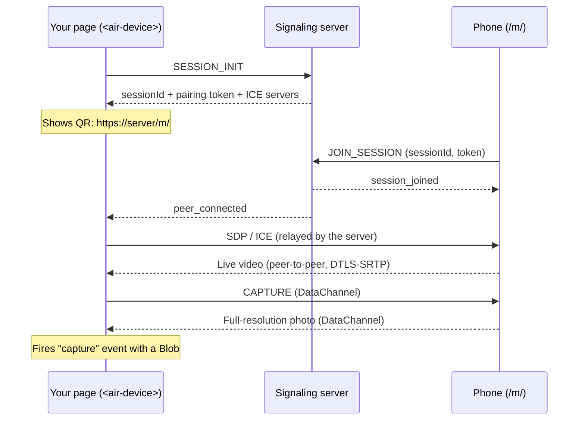

# AirDevice

[](https://github.com/hoakg2000/airdevice/actions/workflows/ci.yml)
[](https://www.npmjs.com/package/@air-device/element)
[](LICENSE)

**Use a phone as a camera for any web page.** Drop one `<air-device>` tag into your site, the user
scans a QR code, and the phone camera streams to the page over WebRTC. Photos come back to your
code as a `Blob`. Your page never deals with WebRTC.

Typical uses: eKYC and ID capture, document scanning, a remote webcam for desktops with no camera.

[Tiếng Việt](README.vi.md)

---

## How it works



- The server only relays signaling messages. Video and photos go **directly** between the phone
  and the page and never touch the server.
- The phone page is served by the same server at `/m/`, so you deploy one container.

## Packages

| Package                                     | What it is                                                                    |
| ------------------------------------------- | ----------------------------------------------------------------------------- |
| [`@air-device/element`](packages/element)   | The `<air-device>` web component. Works with any framework or plain HTML.     |
| [`@air-device/client`](packages/client)     | Headless SDK (`HostSession`, `CameraSession`, `AirDevicePeer`) for custom UI. |
| [`@air-device/protocol`](packages/protocol) | Zod schemas and TypeScript types for every message.                           |
| Docker image (`Dockerfile`)                 | Signaling server + phone page. Required by all of the above.                  |

## Quick start

### 1. Run the server

```bash
git clone https://github.com/hoakg2000/airdevice.git && cd airdevice
docker build -t air-device/server .
docker run -p 3000:3000 air-device/server
curl http://127.0.0.1:3000/health   # {"status":"ok"}
```

> **HTTPS is required.** Phones only allow camera access on HTTPS pages. Put the server behind a
> TLS reverse proxy (Caddy, Nginx, a cloud load balancer) so the phone opens `https://your-host/m/`.
> For a quick test from a phone, a tunnel such as `cloudflared` or `ngrok` works.

### 2. Add the element to your page

With a script tag:

```html
<script src="https://cdn.jsdelivr.net/npm/@air-device/element@0.1.0/dist/air-device.iife.js"></script>

<air-device server-url="https://camera.example.com"></air-device>

<script>
  document.querySelector('air-device').addEventListener('capture', (event) => {
    const { photo, source } = event.detail; // photo is a Blob (image/jpeg)
    const form = new FormData();
    form.append('file', photo, 'capture.jpg');
    fetch('/api/upload', { method: 'POST', body: form });
  });
</script>
```

Or with npm (React is a peer dependency, so your app's copy is reused):

```bash
npm install @air-device/element
```

```ts
import '@air-device/element'; // registers <air-device>; import it in the browser only (not during SSR)
```

<details>
<summary>React example</summary>

```tsx
import { useEffect, useRef } from 'react';
import '@air-device/element';
import type { AirDeviceElement, AirDeviceCaptureDetail } from '@air-device/element';

declare global {
  namespace JSX {
    interface IntrinsicElements {
      'air-device': React.DetailedHTMLProps<
        React.HTMLAttributes<AirDeviceElement>,
        AirDeviceElement
      > & {
        'server-url'?: string;
        'mobile-url'?: string;
      };
    }
  }
}

export function PhoneCamera({ onPhoto }: { onPhoto: (photo: Blob) => void }) {
  const ref = useRef<AirDeviceElement>(null);

  useEffect(() => {
    const el = ref.current;
    const handler = (e: Event) => onPhoto((e as CustomEvent<AirDeviceCaptureDetail>).detail.photo);
    el?.addEventListener('capture', handler);
    return () => el?.removeEventListener('capture', handler);
  }, [onPhoto]);

  return <air-device ref={ref} server-url="https://camera.example.com" lang="en" />;
}
```

In Next.js, load the component with `dynamic(() => import('./PhoneCamera'), { ssr: false })`.

</details>

## Element reference

### Attributes

| Attribute    | Default                                  | Description                                                               |
| ------------ | ---------------------------------------- | ------------------------------------------------------------------------- |
| `server-url` | the page's origin                        | URL of the AirDevice server.                                              |
| `mobile-url` | `<server-url>/m/`                        | Page the phone opens. Change it only if you host the phone page yourself. |
| `lang`       | `<html lang>`, then the browser language | UI language: `en` or `vi`.                                                |

Changing `server-url` or `mobile-url` starts a new session. Removing the element from the DOM
closes the connection and the camera.

### Events

All events bubble and cross the Shadow DOM boundary (`composed: true`).

| Event          | `event.detail`                                  | When                                                    |
| -------------- | ----------------------------------------------- | ------------------------------------------------------- |
| `capture`      | `{ photo: Blob, source: 'device' \| 'stream' }` | A photo was taken (button on the page or on the phone). |
| `paired`       | —                                               | The phone connected.                                    |
| `disconnected` | —                                               | The phone left. The QR code is shown again.             |
| `error`        | `{ code: string, message: string }`             | Connection failure or a rejected session.               |

`source: 'device'` is a full-resolution photo taken by the phone (`ImageCapture` on Android
Chrome, a full video frame elsewhere). `source: 'stream'` is a fallback: a frame grabbed from the
received video when the phone could not send a photo.

### Styling

The element renders inside a Shadow DOM, so your CSS does not leak in. Use CSS custom properties
and `::part()`:

```css
air-device {
  --air-device-accent: #0ea5e9;
  --air-device-accent-hover: #0284c7;
  --air-device-radius: 4px;
  --air-device-video-height: 420px;
}
air-device::part(container) {
  max-width: 640px;
}
```

Variables: `--air-device-accent`, `--air-device-accent-hover`, `--air-device-bg`,
`--air-device-surface`, `--air-device-border`, `--air-device-text`, `--air-device-muted`,
`--air-device-radius`, `--air-device-font`, `--air-device-video-height`.
Parts: `container`, `qr`, `video`, `capture-button`.

## Headless SDK

Build your own UI with `@air-device/client`:

```ts
import { HostSession } from '@air-device/client';

const session = new HostSession({ serverUrl: 'https://camera.example.com' });
session.onPairing = ({ url, expiresAt }) => renderQr(url, expiresAt);
session.onState = (state) => console.log(state); // connecting | waiting | paired | error
session.onStream = (stream) => (video.srcObject = stream);
session.onPhoto = (photo) => upload(photo);
session.start();

captureButton.onclick = () => session.capture(); // false if no DataChannel yet
// session.regenerate() for a new QR code, session.destroy() to clean up
```

`CameraSession` and `parsePairingHash` cover the phone side; see
[`apps/mobile-client`](apps/mobile-client/src/App.tsx) for a complete example.

## Server configuration

| Variable          | Default                                     | Description                                                                   |
| ----------------- | ------------------------------------------- | ----------------------------------------------------------------------------- |
| `PORT`            | `3000`                                      | HTTP / WebSocket port.                                                        |
| `HOST`            | `0.0.0.0`                                   | Bind address.                                                                 |
| `CORS_ORIGINS`    | `*`                                         | Comma-separated origins allowed to open a socket. **Set this in production.** |
| `SESSION_TTL_SEC` | `300`                                       | How long a QR code is valid.                                                  |
| `ICE_SERVERS`     | `[{"urls":"stun:stun.l.google.com:19302"}]` | JSON array of `RTCIceServer`, sent to both peers.                             |
| `REDIS_URL`       | unset                                       | Enables the Redis adapter and session store for multiple instances.           |
| `MOBILE_DIR`      | `/app/public` in Docker                     | Folder with the built phone page, served at `/m/`.                            |

**TURN.** STUN alone fails on many mobile networks (symmetric NAT). For production, run a TURN
server (for example [coturn](https://github.com/coturn/coturn)) and pass it in:

```bash
ICE_SERVERS='[{"urls":"stun:stun.l.google.com:19302"},{"urls":"turn:turn.example.com:3478","username":"u","credential":"p"}]'
```

**Scaling.** One instance handles many sessions. To run several, set `REDIS_URL`
(`docker compose -f docker/docker-compose.yml up --build` starts the server with Redis).

## Security

- Each session has a random UUID and a 128-bit pairing token. The token travels in the URL
  fragment (`#…`), so it is not sent in HTTP requests, server logs or `Referer` headers.
- A session accepts one phone. QR codes expire after `SESSION_TTL_SEC`; a session ends when the
  page that created it disconnects.
- Signaling messages are validated with zod and capped at 64 KB. Photos are capped at 20 MB.
- Media is end-to-end encrypted by WebRTC (DTLS-SRTP) and does not pass through the server.
- Creating sessions is not authenticated. Restrict `CORS_ORIGINS` and add rate limiting at your
  reverse proxy if the server is public.

## Local development

Requirements: Node.js 20+, pnpm 9 (`corepack enable`), a phone on the same Wi-Fi.

```bash
pnpm install
pnpm build:libs                                  # protocol + client are consumed from dist/
cp packages/element/.env.example packages/element/.env
# edit VITE_MOBILE_URL to https://<your-LAN-IP>:5174/
pnpm dev
```

| URL                     | What                                                    |
| ----------------------- | ------------------------------------------------------- |
| `http://localhost:5173` | Demo page with `<air-device>` (open on the computer).   |
| `https://<LAN-IP>:5174` | Phone page (self-signed cert; accept the warning once). |
| `http://localhost:3000` | Signaling server (the phone page proxies `/socket.io`). |

Other commands:

```bash
pnpm test          # all unit tests
pnpm lint          # ESLint
pnpm format        # Prettier
pnpm build         # build every package and app
pnpm dev:infra     # optional Redis in Docker
```

More help: [docs/trouble-shooting.md](docs/trouble-shooting.md).

### Repository layout

```
apps/
  signaling-server/   NestJS + socket.io: sessions, signaling relay, serves /m/
  mobile-client/      Phone page (React): camera, torch, switch camera, photo upload over WebRTC
packages/
  element/            <air-device> web component (published)
  client/             Headless SDK (published)
  protocol/           Zod schemas and types (published)
  config/             Shared tsconfig
docker/               docker-compose (server + Redis), redis.conf
```

### Releasing

Packages are versioned with [Changesets](https://github.com/changesets/changesets). Run
`pnpm changeset`, merge the generated "Version packages" PR, and the release workflow publishes to
npm (needs an `NPM_TOKEN` repository secret).

## Upgrading from the pre-npm version

- The `air-device-frame-captured` event on `window` was replaced by a `capture` event on the
  element. `detail.imageBase64` became `detail.photo` (a `Blob`). Use `URL.createObjectURL(photo)`
  to display it, or `FileReader` if you need base64.
- The server URL and phone URL are no longer hardcoded; set `server-url` (and `mobile-url` if needed).

## Roadmap

- Snapshot mode: the phone uploads a photo from the native camera app, without a live stream.
- Two-way audio.
- Built-in rate limiting and a TURN service in `docker-compose`.

## License

[MIT](LICENSE)
