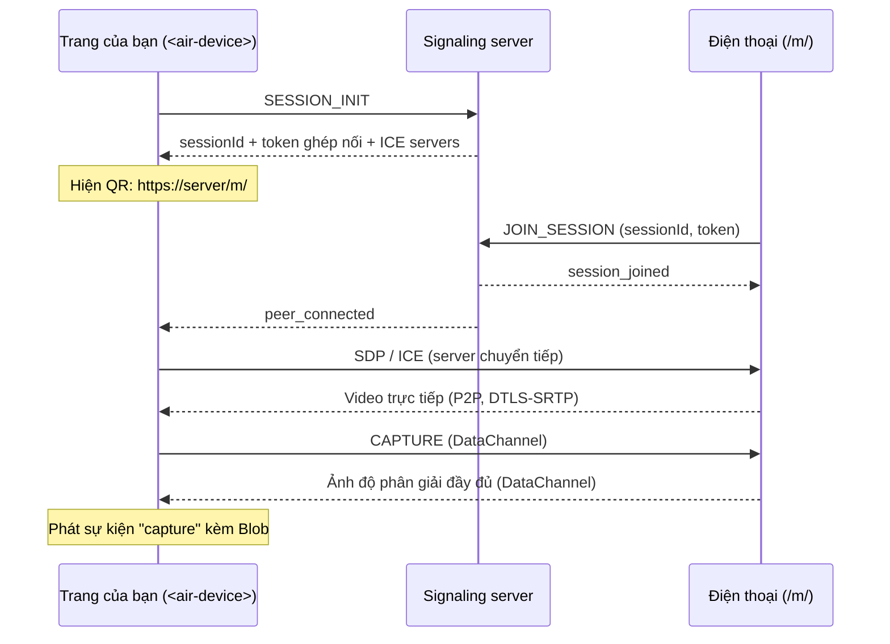

# AirDevice

[](https://github.com/hoakg2000/airdevice/actions/workflows/ci.yml)
[](https://www.npmjs.com/package/@air-device/element)
[](LICENSE)

**Dùng điện thoại làm camera cho bất kỳ trang web nào.** Chỉ cần thêm thẻ `<air-device>` vào trang,
người dùng quét mã QR, camera điện thoại sẽ truyền hình ảnh về trang qua WebRTC. Ảnh chụp được trả
về code của bạn dưới dạng `Blob`. Trang của bạn không cần biết gì về WebRTC.

Ứng dụng điển hình: eKYC và chụp giấy tờ tùy thân, quét tài liệu, webcam từ xa cho máy tính không có
camera.

[English](README.md)

---

## Cách hoạt động



- Server chỉ chuyển tiếp tín hiệu. Video và ảnh đi **trực tiếp** giữa điện thoại và trang, không
  bao giờ qua server.
- Trang cho điện thoại được chính server phục vụ tại `/m/`, nên bạn chỉ cần triển khai một container.

## Các gói

| Gói                                         | Mô tả                                                                        |
| ------------------------------------------- | ---------------------------------------------------------------------------- |
| [`@air-device/element`](packages/element)   | Web component `<air-device>`. Dùng được với mọi framework hoặc HTML thuần.   |
| [`@air-device/client`](packages/client)     | SDK headless (`HostSession`, `CameraSession`, `AirDevicePeer`) để tự làm UI. |
| [`@air-device/protocol`](packages/protocol) | Zod schema và kiểu TypeScript cho mọi message.                               |
| Docker image (`Dockerfile`)                 | Signaling server + trang điện thoại. Bắt buộc cho tất cả các gói trên.       |

## Bắt đầu nhanh

### 1. Chạy server

```bash
git clone https://github.com/hoakg2000/airdevice.git && cd airdevice
docker build -t air-device/server .
docker run -p 3000:3000 air-device/server
curl http://127.0.0.1:3000/health   # {"status":"ok"}
```

> **Bắt buộc HTTPS.** Điện thoại chỉ cho phép dùng camera trên trang HTTPS. Đặt server sau một
> reverse proxy có TLS (Caddy, Nginx, load balancer của cloud) để điện thoại mở
> `https://your-host/m/`. Để thử nhanh trên điện thoại, có thể dùng tunnel như `cloudflared` hoặc `ngrok`.

### 2. Thêm element vào trang

Bằng thẻ script:

```html
<script src="https://cdn.jsdelivr.net/npm/@air-device/element@0.1.0/dist/air-device.iife.js"></script>

<air-device server-url="https://camera.example.com" lang="vi"></air-device>

<script>
  document.querySelector('air-device').addEventListener('capture', (event) => {
    const { photo, source } = event.detail; // photo là Blob (image/jpeg)
    const form = new FormData();
    form.append('file', photo, 'capture.jpg');
    fetch('/api/upload', { method: 'POST', body: form });
  });
</script>
```

Hoặc bằng npm (React là peer dependency, dùng chung bản React của app bạn):

```bash
npm install @air-device/element
```

```ts
import '@air-device/element'; // đăng ký <air-device>; chỉ import trên trình duyệt (không chạy khi SSR)
```

Ví dụ React đầy đủ có trong [README tiếng Anh](README.md#2-add-the-element-to-your-page).
Với Next.js, tải component bằng `dynamic(() => import('./PhoneCamera'), { ssr: false })`.

## Tham chiếu element

### Thuộc tính

| Thuộc tính   | Mặc định                                   | Mô tả                                                          |
| ------------ | ------------------------------------------ | -------------------------------------------------------------- |
| `server-url` | origin của trang                           | URL của AirDevice server.                                      |
| `mobile-url` | `<server-url>/m/`                          | Trang điện thoại mở. Chỉ đổi khi bạn tự host trang điện thoại. |
| `lang`       | `<html lang>`, sau đó ngôn ngữ trình duyệt | Ngôn ngữ giao diện: `en` hoặc `vi`.                            |

Đổi `server-url` hoặc `mobile-url` sẽ tạo phiên mới. Gỡ element khỏi DOM sẽ đóng kết nối và camera.

### Sự kiện

Mọi sự kiện đều bubble và đi qua ranh giới Shadow DOM (`composed: true`).

| Sự kiện        | `event.detail`                                  | Khi nào                                            |
| -------------- | ----------------------------------------------- | -------------------------------------------------- |
| `capture`      | `{ photo: Blob, source: 'device' \| 'stream' }` | Đã chụp ảnh (nút trên trang hoặc trên điện thoại). |
| `paired`       | —                                               | Điện thoại đã kết nối.                             |
| `disconnected` | —                                               | Điện thoại rời đi. Mã QR hiện lại.                 |
| `error`        | `{ code: string, message: string }`             | Lỗi kết nối hoặc phiên bị từ chối.                 |

`source: 'device'` là ảnh độ phân giải đầy đủ do điện thoại chụp (`ImageCapture` trên Chrome
Android, khung hình video đầy đủ ở trình duyệt khác). `source: 'stream'` là phương án dự phòng:
khung hình lấy từ video nhận được khi điện thoại không gửi được ảnh.

### Tùy biến giao diện

Element hiển thị trong Shadow DOM nên CSS của bạn không ảnh hưởng vào trong. Dùng CSS custom
properties và `::part()`:

```css
air-device {
  --air-device-accent: #0ea5e9;
  --air-device-radius: 4px;
  --air-device-video-height: 420px;
}
air-device::part(container) {
  max-width: 640px;
}
```

Biến: `--air-device-accent`, `--air-device-accent-hover`, `--air-device-bg`, `--air-device-surface`,
`--air-device-border`, `--air-device-text`, `--air-device-muted`, `--air-device-radius`,
`--air-device-font`, `--air-device-video-height`. Part: `container`, `qr`, `video`, `capture-button`.

## SDK headless

```ts
import { HostSession } from '@air-device/client';

const session = new HostSession({ serverUrl: 'https://camera.example.com' });
session.onPairing = ({ url, expiresAt }) => renderQr(url, expiresAt);
session.onState = (state) => console.log(state); // connecting | waiting | paired | error
session.onStream = (stream) => (video.srcObject = stream);
session.onPhoto = (photo) => upload(photo);
session.start();

captureButton.onclick = () => session.capture(); // trả về false nếu chưa có DataChannel
```

Phía điện thoại dùng `CameraSession` và `parsePairingHash`; xem ví dụ đầy đủ ở
[`apps/mobile-client`](apps/mobile-client/src/App.tsx).

## Cấu hình server

| Biến              | Mặc định                                    | Mô tả                                                                        |
| ----------------- | ------------------------------------------- | ---------------------------------------------------------------------------- |
| `PORT`            | `3000`                                      | Cổng HTTP / WebSocket.                                                       |
| `HOST`            | `0.0.0.0`                                   | Địa chỉ lắng nghe.                                                           |
| `CORS_ORIGINS`    | `*`                                         | Danh sách origin (phân tách bằng dấu phẩy). **Hãy đặt khi chạy production.** |
| `SESSION_TTL_SEC` | `300`                                       | Thời gian hiệu lực của mã QR.                                                |
| `ICE_SERVERS`     | `[{"urls":"stun:stun.l.google.com:19302"}]` | Mảng JSON `RTCIceServer`, gửi cho cả hai phía.                               |
| `REDIS_URL`       | không đặt                                   | Bật Redis adapter và session store khi chạy nhiều instance.                  |
| `MOBILE_DIR`      | `/app/public` trong Docker                  | Thư mục chứa bản build trang điện thoại, phục vụ tại `/m/`.                  |

**TURN.** Chỉ dùng STUN sẽ thất bại trên nhiều mạng di động (symmetric NAT). Khi chạy thật, hãy
dựng TURN server (ví dụ [coturn](https://github.com/coturn/coturn)) và khai báo trong `ICE_SERVERS`.

**Mở rộng.** Một instance phục vụ được nhiều phiên. Muốn chạy nhiều instance thì đặt `REDIS_URL`
(`docker compose -f docker/docker-compose.yml up --build` chạy server cùng Redis).

## Bảo mật

- Mỗi phiên có UUID ngẫu nhiên và token ghép nối 128-bit. Token nằm trong fragment của URL (`#…`)
  nên không bị gửi trong HTTP request, log server hay header `Referer`.
- Mỗi phiên chỉ nhận một điện thoại. Mã QR hết hạn sau `SESSION_TTL_SEC`; phiên kết thúc khi trang
  tạo ra nó ngắt kết nối.
- Message signaling được kiểm tra bằng zod, giới hạn 64 KB. Ảnh giới hạn 20 MB.
- Media được WebRTC mã hóa đầu cuối (DTLS-SRTP) và không đi qua server.
- Việc tạo phiên không yêu cầu xác thực. Hãy giới hạn `CORS_ORIGINS` và thêm rate limit ở reverse
  proxy nếu server mở công khai.

## Phát triển cục bộ

Yêu cầu: Node.js 20+, pnpm 9 (`corepack enable`), điện thoại dùng chung Wi-Fi.

```bash
pnpm install
pnpm build:libs                                  # protocol + client được dùng từ dist/
cp packages/element/.env.example packages/element/.env
# sửa VITE_MOBILE_URL thành https://<IP-LAN>:5174/
pnpm dev
```

| URL                     | Nội dung                                                        |
| ----------------------- | --------------------------------------------------------------- |
| `http://localhost:5173` | Trang demo có `<air-device>` (mở trên máy tính).                |
| `https://<IP-LAN>:5174` | Trang điện thoại (chứng chỉ tự ký; chấp nhận cảnh báo một lần). |
| `http://localhost:3000` | Signaling server (trang điện thoại proxy `/socket.io`).         |

Lệnh khác: `pnpm test`, `pnpm lint`, `pnpm format`, `pnpm build`, `pnpm dev:infra` (Redis tùy chọn).

Xử lý sự cố: [docs/trouble-shooting.md](docs/trouble-shooting.md).

### Phát hành

Các gói được quản lý phiên bản bằng [Changesets](https://github.com/changesets/changesets). Chạy
`pnpm changeset`, merge PR "Version packages" được tạo ra, workflow release sẽ publish lên npm
(cần secret `NPM_TOKEN` trong repo).

## Nâng cấp từ phiên bản cũ

- Sự kiện `air-device-frame-captured` trên `window` được thay bằng sự kiện `capture` trên element.
  `detail.imageBase64` đổi thành `detail.photo` (một `Blob`). Dùng `URL.createObjectURL(photo)` để
  hiển thị, hoặc `FileReader` nếu cần base64.
- URL server và URL điện thoại không còn bị gán cứng; hãy đặt `server-url` (và `mobile-url` nếu cần).

## Lộ trình

- Chế độ Snapshot: điện thoại tải ảnh từ ứng dụng camera gốc lên, không cần stream trực tiếp.
- Âm thanh hai chiều.
- Rate limit tích hợp và TURN server trong `docker-compose`.

## Giấy phép

[MIT](LICENSE)
